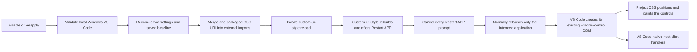

# Architecture decision record

- **Status:** Accepted for version 1
- **Target:** Microsoft Visual Studio Code Desktop on Windows, VS Code >= 1.99
- **Primary objective:** use the smallest practical unsupported VS Code surface
  while preserving native VS Code window-control behavior and making every
  project-owned change reversible and diagnosable

## Decision summary

The extension sets VS Code's public configuration surface to:

```json
{
  "window.titleBarStyle": "custom",
  "window.controlsStyle": "custom"
}
```

That combination asks VS Code to create its own Windows/Linux custom titlebar
and window-control DOM. The implementation then registers one packaged local CSS
file through Custom UI Style's `custom-ui-style.external.imports` setting. CSS
independently positions the existing control container at the upper left,
reserves titlebar space, changes visual order, and draws the macOS-style circles
and glyphs.

VS Code's existing elements remain the interactive controls:

```text
.window-close           -> VS Code closeWindow handler
.window-minimize        -> VS Code minimizeWindow handler
.window-max-restore     -> VS Code maximizeWindow/unmaximizeWindow handler
```

No project code listens for those clicks. The visual layer never decides whether
the window is maximized: VS Code changes the existing maximize/restore element's
codicon state class, and CSS draws the corresponding glyph.



The CSS path and the click path meet at the same DOM elements, but functional
window behavior remains wholly on VS Code's side.

## Why these building blocks

### `window.titleBarStyle = custom`

The custom workbench titlebar is the host for the menu, title/Command Center,
drag region, and custom window-control container. It gives the stylesheet a
workbench-owned titlebar surface without replacing the Electron window frame
from this project.

The setting is application-scoped and VS Code documents that a full restart is
required. The extension records the explicit global baseline before changing it
and asks Custom UI Style to rebuild. On Windows, every upstream **Restart APP**
prompt is cancelled and only the intended Visual Studio Code application is
normally relaunched.

### `window.controlsStyle = custom`

VS Code 1.99 introduced the required Windows/Linux control style. On desktop
Windows with a custom titlebar, `custom` causes VS Code to render
`.window-controls-container` and its minimize, maximize/restore, and close
children. Current upstream code wires those elements directly to the native host
service and updates the maximize/restore class when window state changes.

This is the key simplification: appearance can be changed without implementing
window behavior.

### VS Code's existing control DOM

Keeping the upstream elements provides several properties that a replacement
would need to rediscover and maintain:

- correct targeting of the current VS Code window;
- minimize, maximize, restore, and close calls;
- dirty-editor close confirmation and normal shutdown behavior;
- maximize-state updates and the correct restore action;
- multiple-window targeting;
- interaction with the titlebar drag region, system menu, and fullscreen; and
- whatever accessible semantics VS Code currently supplies.

CSS changes the children from their upstream DOM order—minimize,
maximize/restore, close—to the visual order close, minimize, maximize/restore.
It does not alter their identity or event listeners.

### Custom UI Style external CSS injection

VS Code has no supported API for extension-supplied workbench CSS. Custom UI
Style is therefore the single infrastructure dependency for the unavoidable
injection step. This project uses its external-import mechanism instead of a
large object merged into `custom-ui-style.stylesheet` because a packaged CSS
asset is:

- reviewable and lintable as CSS;
- addressable with `Uri.joinPath(context.extensionUri, ...)` on Windows;
- independently replaceable when an extension version changes its install
  directory; and
- removable as one precisely owned configuration entry.

This project does not directly edit `workbench.desktop.main.css`,
`workbench.desktop.main.js`, `main.js`, `product.json`, or workbench HTML.
Custom UI Style does modify VS Code installation files as its documented
infrastructure mechanism, including backup and rebuild handling. It also
supplies an upstream restart facility, but its inspected Windows implementation
terminates by executable image name and can affect every matching Visual Studio
Code installation. This project therefore requires cancellation of every
**Restart APP** prompt. That dependency-level side effect is disclosed rather
than hidden.

Only the packaged `file:` URI is registered. Normal activation does not fetch
remote code or content.

### CSS-only positioning and reordering

The stylesheet is scoped beneath `.monaco-workbench.windows .part.titlebar`. It
absolutely anchors only `.window-controls-container`, adds left padding to the
titlebar's left content region, and uses child `order` values. It does not
reverse `.titlebar-left` and `.titlebar-right`, transform editor/tree
containers, or globally style every `.window-icon`.

The visual system centralizes circle diameter, gap, left inset, reserved width,
colors, borders, inactive appearance, symbol color, and transition time in CSS
custom properties. The current defaults are a 12 px circle, an 8 px gap, and a
12 px left inset.

## Unsupported surface budget

The design cannot eliminate internal CSS dependencies, but it makes them
explicit. The critical compatibility record tracks:

```text
.window-controls-container
.window-icon
.window-minimize
.window-max-restore
.window-close
```

The complete stylesheet also assumes the Windows workbench and titlebar scope,
the `.titlebar-container`, `.titlebar-left`, `.inactive`, `.fullscreen`,
`.counter-zoom`, `--zoom-factor`, high-contrast workbench classes, and VS Code's
`codicon-chrome-maximize`/`codicon-chrome-restore` state classes. The
maintenance verifier checks the core construction and selector contract; the
manual matrix checks layout and behavior that source search cannot prove.

Selectors are shallow where possible. Internal classes are never treated as a
guarantee. A missing or reorganized selector is a compatibility event requiring
source inspection, a CSS update, and a new manual visual record.

## Reversible state model

Configuration rollback is modeled as state, not as "read the current value and
write it back later." The local UI extension host stores a versioned record in
`ExtensionContext.globalState` under `macosTrafficLights.restorationState`.

For each managed titlebar setting, the record contains:

- the key and desired value (`custom`);
- whether the baseline had no explicit global value or an explicit string value;
- whether the extension completed a write; and
- whether a write was pending when state was last persisted.

The lifecycle record also carries `pendingReload` and `disablePending` flags.
They retain a retry path when a reload request, import cleanup, dependency, or
Disable operation is interrupted. Unknown or malformed saved state is rejected
with a recovery-oriented error instead of silently inventing an empty baseline.

The external-import record separately distinguishes an absent explicit global
array from an explicit array and retains the effective baseline. Known owned
URIs are kept across Disable so a later version can still identify and remove
stale imports.

### Enable transaction

1. Validate the application, desktop UI kind, Windows platform, version, Custom
   UI Style dependency, and external load strategy.
2. Inspect both managed settings. A workspace or workspace-folder override that
   is not already `custom` is reported instead of being silently masked.
3. If this is a fresh enable, capture explicit global baselines and the import
   baseline, mark the lifecycle enabled with `pendingReload: true`, and persist
   state before writes. Reapply also marks the reload pending before repair.
4. Before each setting update, persist `pendingWrite: true`. After the update,
   persist that the extension wrote it and clear the pending marker.
5. Confirm the effective value actually became `custom`.
6. Reconcile imports by removing every precisely owned current, duplicate, or
   stale entry, then inserting one current URI at the first owned position (or
   the end when none existed). Preserve all unrelated JSON entries and order.
7. Invoke `custom-ui-style.reload`; clear the pending-reload marker only after
   the command returns. If the call rejects, leave it pending so Enable/Reapply
   can be retried.

Validation occurs before baseline creation, so a `disable` load strategy or an
unsupported environment does not intentionally leave a half-enabled record.
Persisting state before side effects makes an interrupted write conservative:
Disable can treat the pending operation as extension-owned if the resulting
value is `custom`.

Repeated Enable reuses the original baseline and produces no duplicate imports.

### Ownership predicate

An external import is owned only when either:

- its normalized URI exactly matches the current or a recorded prior URI; or
- it is a `file:` URL on the same URL host and beneath the same extension
  installation parent as the current package, whose final path is exactly
  `assets/macos-traffic-lights.css` and whose containing extension directory
  exactly matches this extension ID plus VS Code's versioned installation suffix
  convention.

Malformed URLs, remote URLs, object entries, similarly named files, matching
paths under another extension root, and other extensions' resources are
unrelated. A broad substring search for `macos-traffic-lights.css` is
intentionally insufficient.

### Disable transaction

1. Persist `disablePending: true` and `pendingReload: true` before cleanup side
   effects whenever an enabled, pending, or newly discovered owned state needs
   work.
2. Remove only imports accepted by the ownership predicate.
3. If an import baseline was globally absent and removal recreates the former
   effective array, remove the explicit global import value. Otherwise write the
   merged array, preserving additions and edits made while enabled.
4. If import inspection/removal fails, retain that error but continue restoring
   managed window settings; one malformed/unavailable dependency setting must
   not prevent the safer titlebar rollback.
5. For every setting actually or possibly written by the extension:
   - if its current explicit global value is still `custom`, restore the saved
     explicit value or remove the explicit value to restore absence;
   - if its value no longer equals `custom`, preserve the user's later change
     and report it; and
   - if the extension never wrote it, leave it untouched.
6. If import cleanup succeeded, request Custom UI Style reload. If the
   dependency is unavailable or that request rejects, retain the pending state
   and instruct the user to correct the issue and run Disable again.
7. Only after the reload command returns, replace the transaction with an empty
   disabled state while retaining URI ownership history.

Every successfully completed setting restoration remains in place if a later
step fails. Repeated Disable resumes the retained transaction; after a completed
Disable, another run finds no owned configuration to change and reports that the
extension was already disabled.

### Reapply and activation reconciliation

Reapply requires an enabled lifecycle record. It deliberately repairs the two
managed settings to `custom` and reconciles the current import while retaining
the original pre-Enable baseline. It does not reset unrelated configuration.
Because this is an explicit repair command, it can overwrite a manual change to
one of the two managed settings made while enabled; use Disable when that change
should be preserved.

Enable and Reapply reject a state with `disablePending: true` and direct the
user back to Disable. Mixing repair with incomplete rollback could otherwise
erase or reinterpret the baseline needed to finish cleanup.

On activation, an enabled extension calculates its current asset URI. If an
upgrade changed the versioned extension directory, it replaces stale owned
imports with the current URI, preserves unrelated entries, and offers Reapply to
request a Custom UI Style rebuild. The resulting **Restart APP** prompt must be
cancelled on Windows; declining Reapply leaves the configuration reconciled but
does not update the current renderer.

Startup recovery banners are passive with respect to the shared operation queue.
The interrupted-Disable and pending-reload branches register a selection handler
and return after their state/configuration work; they do not await the
notification's potentially unbounded display lifetime. Selecting the exact
offered action later queues Disable or Reapply, while dismissing or hiding the
banner cannot indefinitely delay a new explicit command.

## Custom UI Style reload and cache contract

The extension invokes only the public `custom-ui-style.reload` command. In the
inspected Custom UI Style 0.7.1 source:

- external resources are merged during reload and are not live-watched;
- `refetch` reads them on every reload and is the default;
- `cache` skips reads when the set of resource type/URI keys is unchanged and
  prior reads succeeded—it does not hash local file contents;
- `disable` clears/omits generated external resources; and
- VS Code 1.95+ uses the full application restart path, normally after a user
  prompt unless Custom UI Style is configured to proceed without prompting.
- on Windows, the inspected restart path derives the executable image name,
  force-terminates every matching process by that name, waits for all matching
  processes to exit, and then launches a binary resolved from the initiating
  copy. It is not installation- or profile-scoped.

The inspected reload wrapper catches and logs some internal patch failures
without rejecting its public command. Therefore “reload requested” or a returned
command is not proof that application files were rebuilt or a new renderer was
started. The user must select **Cancel** on every Custom UI Style **Restart
APP** prompt, inspect its output, normally relaunch only the intended Visual
Studio Code application, and visually verify the result. The extension's pending
marker covers a rejected command call, but it cannot observe an upstream failure
that Custom UI Style swallows.

Custom UI Style also watches configuration by default (while documenting that
imports themselves are ignored by that watcher). The managed titlebar setting
write or writes may trigger watcher behavior in addition to this extension's
explicit reload request. A possible duplicate restart prompt remains an
unverified manual-test case.

This extension reads the strategy but never rewrites it. Enable/Reapply reject
`disable`, allow `cache` with an explanatory result, and recommend `refetch`.
Same-URI CSS development in `cache` mode can remain stale; versioned packaged
upgrades normally change the URI and therefore the cache key.

Both managed VS Code titlebar settings also declare that a full restart is
needed. A successful configuration update or returned reload request is
therefore not evidence that the current renderer has changed until the Custom UI
Style output is clean, every **Restart APP** prompt has been cancelled, only the
intended Visual Studio Code application has been normally relaunched, and the
visuals are checked.

## Local UI and Remote - WSL model

The feature modifies the local desktop chrome, not workspace files. The package
declares:

```json
{
  "extensionKind": ["ui"]
}
```

When a folder is opened through Remote - WSL:

- the repository and language tooling may run in WSL;
- this extension runs in the local Windows UI extension host;
- Custom UI Style also runs and patches on the local Windows side;
- `process.platform` must therefore be `win32`; and
- the packaged CSS URI comes from the local installed extension, not a Linux
  remote path.

`Uri.joinPath` constructs the asset URI, and the command rejects any result
whose scheme is not `file`. No manually concatenated drive letter or WSL path
crossing is used.

## Module boundaries

| Area                 | Responsibility                                                                             |
| -------------------- | ------------------------------------------------------------------------------------------ |
| `src/extension.ts`   | Register commands, output channel, error boundary, and activation reconciliation.          |
| `src/commands/`      | Orchestrate validation, apply, rollback, repair, and diagnostics.                          |
| `src/compatibility/` | Detect/classify the application environment and version against `compatibility.json`.      |
| `src/configuration/` | Inspect managed setting scopes and implement pure capture/restoration decisions.           |
| `src/integration/`   | Narrow adapter around Custom UI Style configuration, dependency state, and reload command. |
| `src/resources/`     | Pure URI ownership, insertion, deduplication, stale replacement, counting, and removal.    |
| `assets/`            | Original, titlebar-scoped CSS presentation only.                                           |
| `scripts/`           | Explicit, network-capable upstream maintenance checks; never runtime behavior.             |

Side effects stay at command/integration boundaries. Merge, ownership,
restoration, version comparison, environment classification, and dependency
classification are pure and unit-testable without a VS Code renderer or user
installation.

## Rejected alternatives

| Alternative                                              | Reason rejected                                                                                                                                                                                  |
| -------------------------------------------------------- | ------------------------------------------------------------------------------------------------------------------------------------------------------------------------------------------------ |
| APC CustomizeUI++                                        | It expands the dependency and patching surface, the referenced prior-art project is already deprecated because of APC compatibility, and modern VS Code exposes `window.controlsStyle`.          |
| `titleBarStyle: hiddenInset` on Windows                  | It is not the modern Windows control contract and would require Electron/main-process intervention instead of using VS Code's supported configuration shape.                                     |
| `custom-ui-style.electron: { "frame": false }`           | Frameless Electron windows make the project responsible for more native window behavior and platform edge cases. This setting is never written.                                                  |
| Direct `BrowserWindow` patching                          | It couples the project to Electron main-process construction, compiled/minified VS Code internals, restart behavior, and version-specific tokens.                                                |
| Direct edits to VS Code CSS, JS, HTML, or `product.json` | They duplicate Custom UI Style's backup/rollback machinery and would make ownership and recovery harder. This extension delegates only the unavoidable injection infrastructure.                 |
| Replacement HTML controls                                | New elements would need hit testing, state, accessibility, multi-window targeting, native operations, and future upstream behavior. Existing controls already provide these.                     |
| Custom minimize/maximize/restore/close JavaScript        | Dispatching commands or monkey-patching `INativeHostService` adds functional risk and can diverge from VS Code's current-window and dirty-state behavior.                                        |
| Renderer JavaScript injection                            | It is unnecessary for presentation, increases the attack and compatibility surface, and would weaken the CSS/function boundary.                                                                  |
| Reversing `.titlebar-left` and `.titlebar-right`         | It moves menus and other titlebar content, creates broad layout side effects, and was a principal weakness of the behavioral prior art. Only the controls container is independently positioned. |
| Writing a large `custom-ui-style.stylesheet` object      | It is harder to lint, version, identify, and remove than one packaged external CSS URI, and merging object keys creates additional ownership ambiguity.                                          |
| A VS Code fork                                           | It provides control at the cost of continuously rebasing, distributing, and securing a full editor build—far beyond the narrow visual requirement.                                               |

## Safety and security constraints

The runtime extension:

- registers only its packaged local CSS file;
- makes no normal-activation network requests;
- does not download or inject JavaScript;
- does not disable Content Security Policy or alter webview CSP;
- does not patch another extension;
- does not configure `custom-ui-style.electron`, stylesheet objects, webview
  options, or extension-patching options; and
- does not run Custom UI Style against a user installation in automated unit
  tests.

The upstream verifier may access GitHub only when explicitly run by a maintainer
or by the separate upstream workflow. Core CI remains deterministic and
network-independent apart from ordinary locked dependency installation.

## Verification boundary

Unit tests can prove configuration decisions, platform/version classification,
dependency abstraction, and import ownership. Source verification can prove that
expected concepts still occur upstream. Neither can prove visual layout, click
targeting, drag regions, display scaling, theme contrast, or accessible behavior
in the actual Electron renderer.

Those properties require the documented Windows matrix. VS Code 1.132.0 has a
recorded isolated Windows qualification covering Passes A-C and the
release-blocking Pass D core with a clean final rollback. The record explicitly
discloses non-release-blocking controller and hardening deferrals; no
accessibility-conformance or untested-version claim follows from that result.
